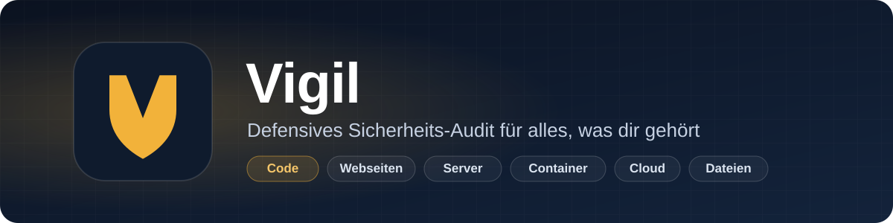
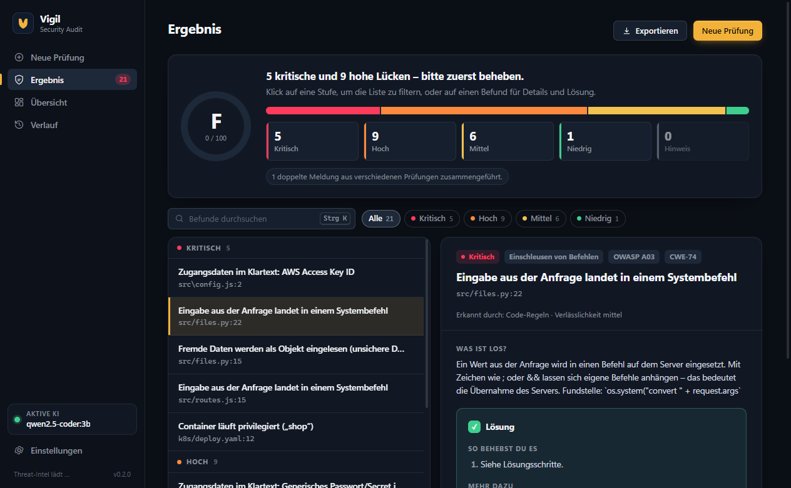
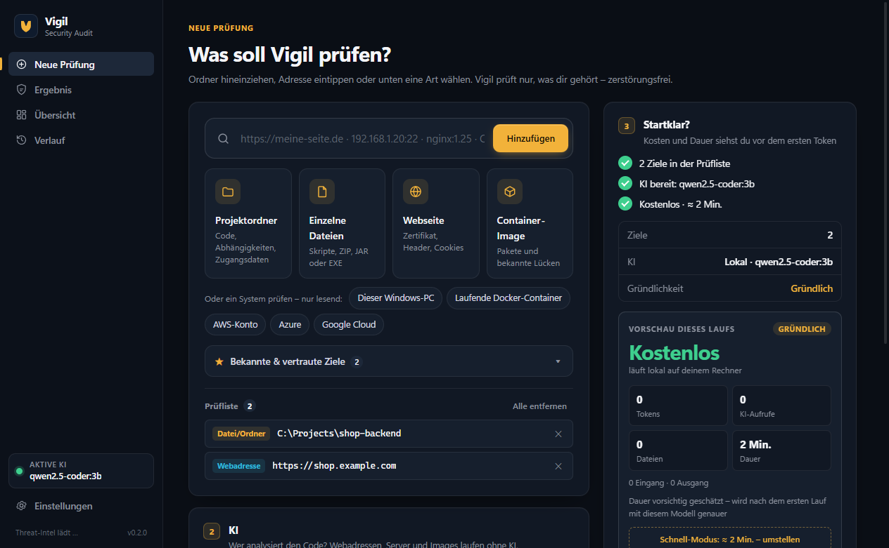
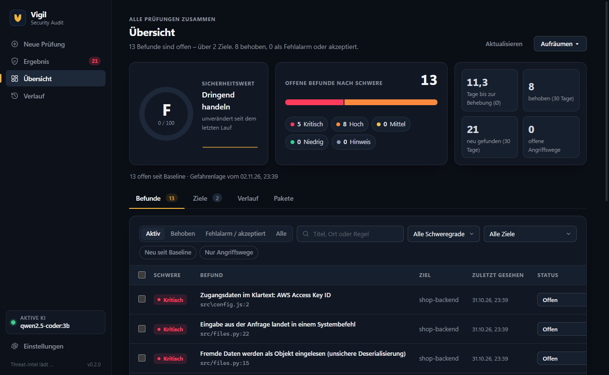
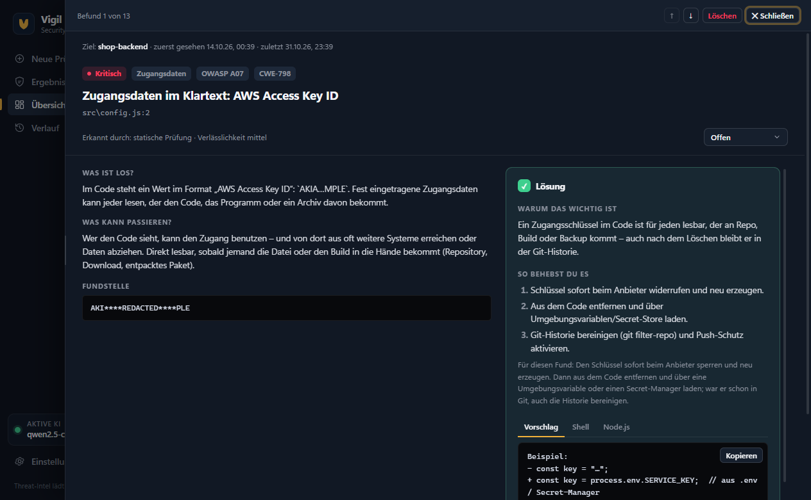
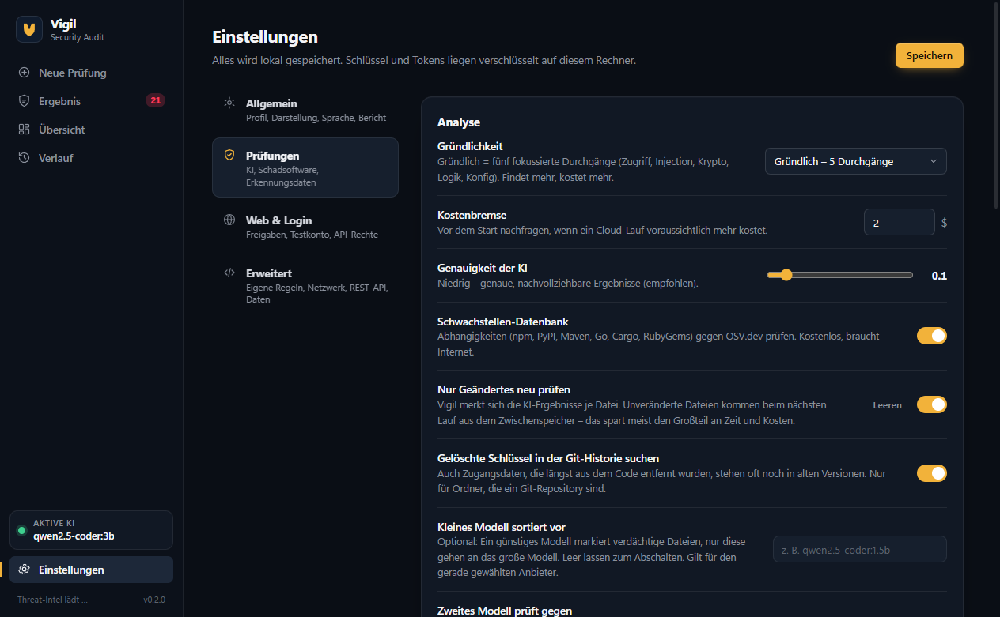
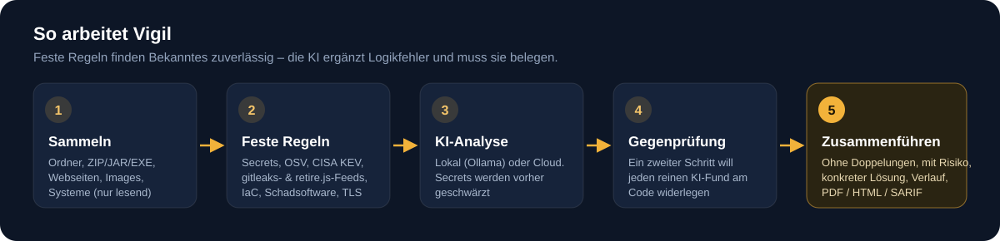

<p align="center">
  
</p>

<p align="center">
  <a href="README.md">English</a> · <b>Deutsch</b>
</p>

<p align="center">
  <a href="LICENSE"></a>
  
  
  
  
</p>

Vigil ist eine Desktop-App, die **deine eigenen** Projekte, Webseiten, Server, Container, Cloud-Konten und Dateien auf Sicherheitsprobleme prüft – und in Klartext erklärt, was los ist und wie du es behebst.

Vigil kombiniert **feste Regeln und tagesaktuelle Schwachstellen-Datenbanken** (die Bekanntes zuverlässig finden) mit einer **KI-Prüfung** (lokal über Ollama oder mit Claude, OpenAI, Gemini bzw. jedem OpenAI-kompatiblen Dienst), die Logik- und Zugriffsfehler sucht – und jeden Fund in einer Gegenprüfung **belegen** muss. Alles läuft **zerstörungsfrei**: keine Angriffe, keine Last-Tests, keine Passwort-Rateversuche.

<p align="center">
  
</p>

## Auf einen Blick

- **Ein Ort für alles, was dir gehört** – Ordner oder ZIP/JAR/EXE hineinziehen, Webadresse, Server oder Container-Image eintippen oder *Dieser Windows-PC*, Docker, AWS, Azure bzw. Google Cloud wählen (nur lesend).
- **Verständliche Ergebnisse** – Sicherheitsnote, Befunde nach Risiko sortiert, ohne Doppelungen, und zu jedem: Was ist los, was kann passieren, und eine konkrete Lösung mit kopierfertigen Schnipseln.
- **Die KI muss sich beweisen** – reine KI-Funde werden am Code gegengeprüft; widerlegte fallen weg, unklare werden als *unbestätigt* markiert.
- **Datenschutz zuerst** – mit Ollama verlässt nichts den Rechner. Bei Cloud-KI werden erkannte Secrets vorher geschwärzt. Schlüssel und Tokens liegen verschlüsselt auf dem PC.
- **Immer aktuell, ohne App-Update** – Erkennungsdaten (gitleaks-Regeln, retire.js, CISA KEV, EPSS, OSV) werden automatisch geladen und geprüft, mindestens einmal am Tag.
- **Kennt deinen Verlauf** – Befunde werden über alle Läufe verfolgt: neu, behoben, wieder da, Fehlalarm, Risiko akzeptiert – dazu Trend, Baseline und Paketsuche (SBOM).
- **Berichte für alle** – einseitiger Kurzbericht für die Geschäftsführung (PDF), ausführlicher Bericht als PDF/HTML/Markdown, SARIF und JSON für CI.
- **Kosten und Dauer vorab** – du siehst geschätzte Kosten und Dauer vor dem ersten Token; die Schätzung lernt aus deinen echten Läufen.

## Bilder

| Neue Prüfung | Übersicht |
| --- | --- |
|  |  |
| **Befund-Details** | **Einstellungen** |
|  |  |

## So arbeitet Vigil

<p align="center">
  
</p>

1. **Sammeln** – Dateien, Ordner, Archive und Programme werden in Prüf-Einheiten zerlegt; Webseiten, Server und Systeme werden nur passiv gelesen.
2. **Feste Regeln & Datenbanken** – Zugangsdaten (auch gelöschte in der Git-Historie), verwundbare Abhängigkeiten (OSV), aktiv ausgenutzte CVEs (CISA KEV), IaC (Terraform, Kubernetes, CloudFormation, Ansible), Container, Office-Makros und PDF-Skripte, Schadsoftware (Microsoft Defender, Signaturen, optional MalwareBazaar), TLS, Header, Cookies, DNS/Mail und mehr. Installierte Tools wie semgrep, trivy, gitleaks oder bandit werden automatisch genutzt.
3. **KI-Analyse** – fokussierte Durchgänge (Zugriff, Injection, Krypto, Logik, Konfiguration) verfolgen Daten von der Quelle zur Senke. Unveränderte Dateien kommen aus dem Zwischenspeicher – wiederholte Läufe sind schnell und günstig.
4. **Gegenprüfung** – ein zweiter KI-Schritt versucht, jeden reinen KI-Fund am konkreten Code-Ausschnitt zu widerlegen.
5. **Zusammenführen & Bericht** – Doppelungen werden vereint, jeder Befund bekommt ein Kontext-Risiko (CVSS, KEV, EPSS, Erreichbarkeit) und eine Lösung; mehrere Schwächen können zu einem *Angriffsweg* verknüpft werden.

## Was Vigil prüft

| Bereich | Beispiele |
| --- | --- |
| Code | Injection, XSS, Path Traversal, SSRF, unsichere Deserialisierung, JWT ohne Prüfung, Prototype Pollution, schwache Krypto, `Math.random()` für Tokens, Datenflüsse über mehrere Dateien – JS/TS, Python, Java, Go, Rust, C#, PHP, Kotlin, Swift |
| Zugangsdaten | API-Schlüssel, Passwörter, private Schlüssel, Connection-Strings – im aktuellen Code und in der Git-Historie (immer geschwärzt) |
| Abhängigkeiten | Bekannte CVEs (OSV), aktiv ausgenutzte (KEV), Ausnutzungs-Wahrscheinlichkeit (EPSS), Erreichbarkeit, verwundbare JS-Bibliotheken, Lizenzen, Lieferkette (Tippfehler-Pakete, Install-Skripte, ungepinnte Actions) |
| Infrastruktur | Dockerfiles, Compose, Kubernetes, Terraform, CloudFormation, Ansible, GitHub Actions |
| Webseiten | Zertifikat und Protokolle, Sicherheits-Header, CSP, Cookies, CORS, offen liegende Dateien (`.env`, `.git`, SourceMaps), DNS & Mail (SPF, DMARC, DKIM, CAA, Subdomain-Takeover). Für nachgewiesene Domains zusätzlich: Unterseiten-Durchgang, harmlose Testwerte in Parametern, Browser-Laufzeitprüfung, Login-Prüfung mit Testkonto, API-Rechtematrix (BOLA/IDOR) |
| Dateien & Programme | Schadsoftware-Scan, digitale Signaturen, Office-Makros, nachgeladene Vorlagen, JavaScript in PDFs, RTF-Objekte, Android-/iOS-Apps |
| Systeme (nur lesend) | Dieser Windows-PC, laufende Docker-Container, AWS, Azure, Google Cloud |

## Sicher von Grund auf

Vigil ist für Systeme gedacht, **die dir gehören oder die du ausdrücklich prüfen darfst**.

- Webadressen und Server prüft Vigil nur, wenn sie auf der **Freigabeliste** stehen oder du die Berechtigung beim Hinzufügen bestätigst. `example.com` gilt auch für Subdomains, `*.example.com` nur für Subdomains.
- Tiefe Web-Prüfungen laufen nur für **nachgewiesene Domains** (DNS-TXT `_sec-audit-verify.<domain>` oder `/.well-known/sec-audit.txt` mit dem Token aus der Übersicht) oder interne Adressen.
- Alle Web-Checks sind passiv und gedrosselt (höchstens 2 parallel, mindestens 400 ms Abstand je Host). Drosselt ein Ziel (3× 429/503/403), bricht das Modul ab, damit deine IP nicht gesperrt wird.
- Keine Angriffs-Payloads, keine Brute-Force-Versuche, keine Last-Tests, und Formulare werden nie abgeschickt – die Login-Prüfung nutzt nur dein Testkonto auf deinem eigenen Host.
- Externe Tools laufen über `spawn` mit Argument-Arrays, ohne Shell. Eingaben und Tool-Ausgaben werden mit **Zod** geprüft.
- Vigil schlägt Patches vor, wendet sie aber nie selbst an.

## Befund-Lebenszyklus

Vigil merkt sich jeden Befund über alle Läufe (lokal in `findings-store.json` im App-Datenordner). Der Fingerabdruck ist `SHA-256(Ziel:Scanner:Regel-ID:Ort)`.

| Status | Bedeutung |
| --- | --- |
| Offen / In Arbeit | aktiv; bei jedem Fund wird „zuletzt gesehen“ aktualisiert |
| Fehlalarm / Risiko akzeptiert | ausgeblendet; bleibt so, auch wenn der Befund wieder auftaucht. Vigil lernt daraus und weist die KI beim nächsten Lauf darauf hin |
| Behoben | von Hand oder automatisch, wenn ein vollständig gelaufener Scanner den Befund nicht mehr findet |

Taucht ein behobener Befund wieder auf, steht er erneut auf „Offen“ und ist als **Regression** markiert. KI-Befunde werden nie automatisch geschlossen. Bei Secrets speichert Vigil nur eine geschwärzte Fundstelle, nie den Klartext. In der Übersicht lassen sich Befunde, Ziele und Läufe auch löschen.

## Loslegen

**Voraussetzungen:** Windows 10/11 und [Node.js](https://nodejs.org) 20 oder neuer. Optional: [Ollama](https://ollama.com) für kostenlose, private KI auf dem eigenen Rechner, oder ein API-Schlüssel für Claude, OpenAI oder Gemini.

```bash
git clone https://github.com/Passimoritz/vigil.git
cd vigil
npm install
npm start
```

Beim ersten Start erscheint eine kurze Einführung. **Beispiel-Lauf ansehen** prüft das mitgelieferte, absichtlich unsichere Übungsprojekt in wenigen Sekunden – ganz ohne KI.

Die Sprache stellst du unter *Einstellungen → Allgemein* auf Deutsch um (Standard ist Englisch).

API-Schlüssel kannst du in der App eintragen (verschlüsselt gespeichert) oder in eine `.env`-Datei schreiben – siehe [`.env.example`](.env.example).

> **Windows Smart App Control:** Unsignierte Builds werden unter Umständen blockiert. Starte Vigil dann wie oben aus dem Quellcode oder lies [SIGNING.md](SIGNING.md) zu signierten Builds.

### Kommandozeile

```bash
node src/cli.js --provider ollama --model qwen2.5-coder:7b --out bericht.html ./mein-projekt
node src/cli.js --provider anthropic --url https://meine-seite.example
node src/cli.js --image nginx:1.25
```

### Lokale REST-API

Einschaltbar unter *Einstellungen → Erweitert*. Sie lauscht nur auf `127.0.0.1` (Standard-Port 7811), verlangt das angezeigte Bearer-Token, weist Browser-Anfragen ab und prüft ausschließlich Ziele von der Freigabeliste.

| Methode | Pfad | Zweck |
| --- | --- | --- |
| GET | `/api/stats` | offene Befunde nach Schwere, Ziele, letzte Läufe |
| GET | `/api/targets` | Ziele mit offenen Befunden |
| GET | `/api/findings?status=OPEN&severity=high&targetId=&q=` | Befunde filtern |
| PATCH | `/api/findings/:id/status` | `{ "status": "FALSE_POSITIVE", "note": "…" }` |
| POST | `/api/scans` | `{ "targets": [{ "type": "url", "value": "https://…" }] }` → `202 { scanId }` |
| GET | `/api/scans/:id` | Status `QUEUED` / `RUNNING` / `COMPLETED` / `FAILED` |

```bash
curl -H "Authorization: Bearer <Token>" "http://127.0.0.1:7811/api/findings?status=OPEN"
```

Prüfungen laufen nacheinander über eine Warteschlange, egal ob sie aus der App oder über die API kommen.

## Entwicklung

```bash
npm test          # Kern-Tests
npm run e2e       # echtes App-Fenster: Klickwege und Barrierefreiheit
npm run bench     # Trefferquote am Übungsprojekt (mit KI: npm run bench -- ollama qwen2.5-coder:14b)
npm run dist      # Windows-Installer (electron-builder)
```

```
electron/     App-Fenster, IPC, Prüf-Warteschlange, lokale REST-API, Ollama-Einrichtung
src/core/     Einlesen, Regeln, Module, Feeds, KI-Anbieter, Analyse, Befund-Speicher, Berichte
src/ui/       Oberfläche (index.html, styles.css, renderer.js, i18n.js)
src/cli.js    Kommandozeile
bench/        absichtlich unsicheres Übungsprojekt mit erwarteten Befunden
test/         Kern- und Oberflächen-Tests
```

Neuer KI-Anbieter: in `src/core/providers.js` einen Eintrag und einen Aufruf ergänzen – der Rest bleibt gleich.

## Roadmap, Signieren, Lizenz

- Geplante Erweiterungen: [ROADMAP.md](ROADMAP.md)
- Signieren: [SIGNING.md](SIGNING.md) · Richtlinie: [CODE_SIGNING.md](CODE_SIGNING.md)
- Lizenz: [MIT](LICENSE)
