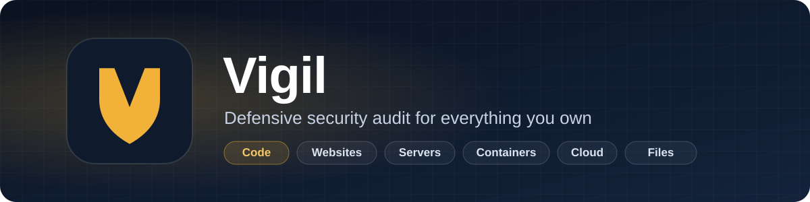
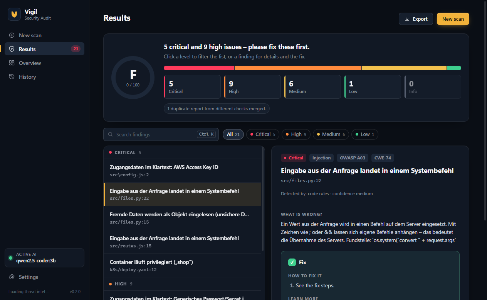
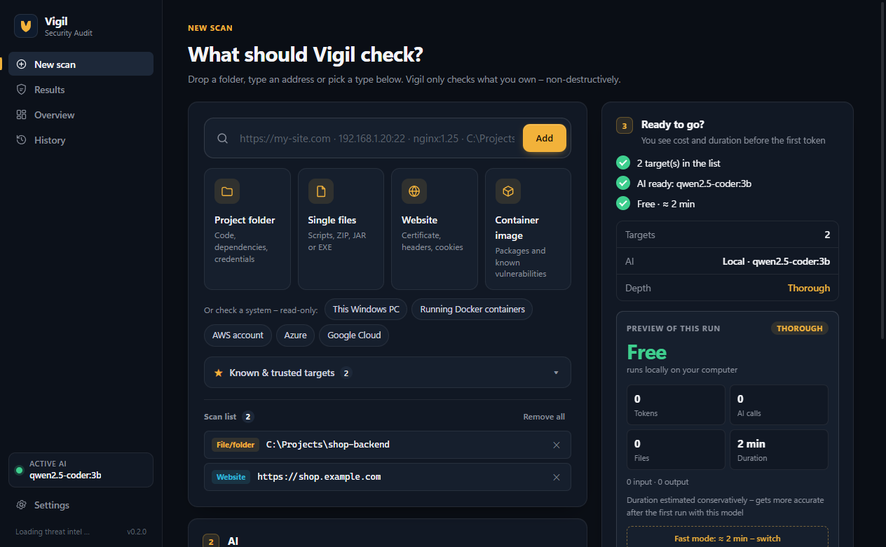
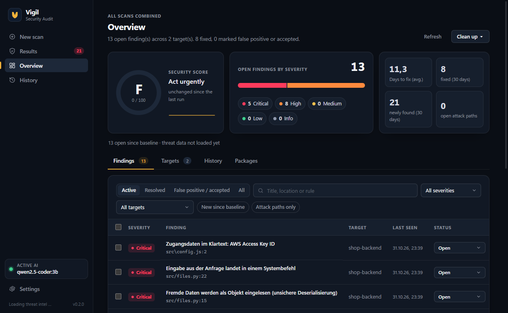
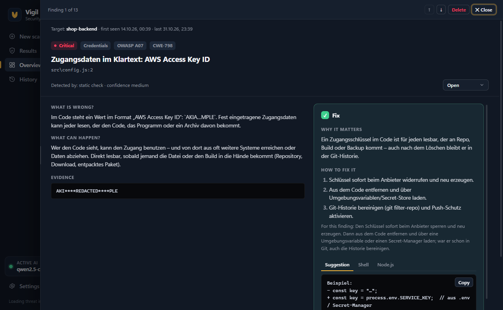
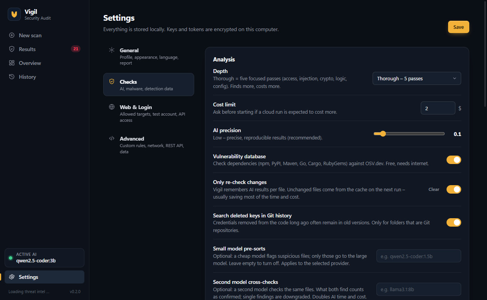
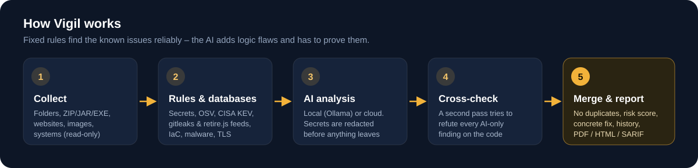

<p align="center">
  
</p>

<p align="center">
  <b>English</b> · <a href="README.de.md">Deutsch</a>
</p>

<p align="center">
  <a href="LICENSE"></a>
  
  
  
  
</p>

Vigil is a desktop app that checks **your own** code, websites, servers, containers, cloud accounts and files for security problems – and explains in plain language what is wrong and how to fix it.

It combines **fixed rules and live vulnerability databases** (which find known problems reliably) with an **AI review** (local via Ollama, or Claude, OpenAI, Gemini or any OpenAI-compatible service) that looks for logic and access flaws – and then has to **prove** every finding in a second cross-check. Everything is **non-destructive**: no attacks, no load tests, no password guessing.

<p align="center">
  
</p>

## Highlights

- **One place for everything you own** – drop a folder, a ZIP/JAR/EXE, type a URL, a server or a container image, or pick *This Windows PC*, Docker, AWS, Azure or Google Cloud (read-only).
- **Clear results** – a security grade, findings sorted by risk, no duplicates, and for each one: what is wrong, what can happen, and a concrete fix with copy-ready snippets.
- **AI that has to prove itself** – AI-only findings are cross-checked against the code; refuted ones are dropped, unclear ones are marked *unconfirmed*.
- **Privacy first** – with Ollama nothing leaves your computer. With cloud AI, detected secrets are redacted before sending. Keys and tokens are stored encrypted.
- **Up to date without app updates** – detection data (gitleaks rules, retire.js, CISA KEV, EPSS, OSV) is fetched and validated automatically, at least once a day.
- **Knows your history** – findings are tracked across runs: new, fixed, back again, false positive, accepted risk, plus trend, baseline and package search (SBOM).
- **Reports for everyone** – one-page executive summary (PDF), full PDF/HTML/Markdown report, SARIF and JSON for CI.
- **Cost and time up front** – you see the estimated cost and duration before the first token; the estimate learns from your real runs.

## Screenshots

| New scan | Overview |
| --- | --- |
|  |  |
| **Finding details** | **Settings** |
|  |  |

## How it works

<p align="center">
  
</p>

1. **Collect** – files, folders, archives and binaries are unpacked into units; websites, servers and systems are read passively.
2. **Rules & databases** – secrets (including deleted ones in Git history), vulnerable dependencies (OSV), actively exploited CVEs (CISA KEV), IaC (Terraform, Kubernetes, CloudFormation, Ansible), containers, Office macros and PDF scripts, malware (Microsoft Defender, signatures, optional MalwareBazaar), TLS, headers, cookies, DNS/mail and more. Installed tools such as semgrep, trivy, gitleaks or bandit are used automatically.
3. **AI analysis** – focused passes (access, injection, crypto, logic, config) follow data from source to sink. Unchanged files come from a cache, so repeat runs are fast and cheap.
4. **Cross-check** – a second AI step tries to refute every AI-only finding on the concrete code snippet.
5. **Merge & report** – duplicates are merged, each finding gets a context risk score (CVSS, KEV, EPSS, reachability) and a fix; several weaknesses can be linked into an *attack path*.

## What Vigil checks

| Area | Examples |
| --- | --- |
| Code | Injection, XSS, path traversal, SSRF, unsafe deserialization, JWT without verification, prototype pollution, weak crypto, `Math.random()` for tokens, taint flows across files – JS/TS, Python, Java, Go, Rust, C#, PHP, Kotlin, Swift |
| Credentials | API keys, passwords, private keys, connection strings – in current code and in Git history (always redacted) |
| Dependencies | Known CVEs (OSV), actively exploited ones (KEV), exploit probability (EPSS), reachability, vulnerable JS libraries, licenses, supply chain (typosquatting, install scripts, unpinned actions) |
| Infrastructure | Dockerfiles, Compose, Kubernetes, Terraform, CloudFormation, Ansible, GitHub Actions |
| Websites | Certificate and protocols, security headers, CSP, cookies, CORS, exposed files (`.env`, `.git`, source maps), DNS & mail (SPF, DMARC, DKIM, CAA, subdomain takeover). For verified domains also: crawl, harmless test values in parameters, browser runtime check, login check with a test account, API access matrix (BOLA/IDOR) |
| Files & programs | Malware scan, digital signatures, Office macros, remote templates, PDF JavaScript, RTF objects, Android/iOS apps |
| Systems (read-only) | This Windows PC, running Docker containers, AWS, Azure, Google Cloud |

## Safe by design

Vigil is meant for systems **you own or are explicitly allowed to test**.

- Websites and servers are only checked after you confirm you are authorised; deep web checks require a **verified domain** (DNS TXT record or `/.well-known/sec-audit.txt`).
- All web checks are passive and rate-limited; if a target starts throttling, the check stops.
- No exploit payloads, no brute force, no load tests, and forms are never submitted – the login check only uses your test account, on your own host.
- Vigil suggests patches but never applies them.

## Getting started

**Requirements:** Windows 10/11 and [Node.js](https://nodejs.org) 20 or newer. Optional: [Ollama](https://ollama.com) for free, private local AI, or an API key for Claude, OpenAI or Gemini.

```bash
git clone https://github.com/Passimoritz/vigil.git
cd vigil
npm install
npm start
```

On first start a short introduction appears. **View a sample run** checks the bundled, deliberately vulnerable practice project in a few seconds – no AI needed.

API keys can be entered in the app (stored encrypted) or put into a `.env` file – see [`.env.example`](.env.example).

> **Windows Smart App Control:** unsigned builds may be blocked. Run Vigil from source as shown above, or see [SIGNING.md](SIGNING.md) for signed builds.

### Command line

```bash
node src/cli.js --provider ollama --model qwen2.5-coder:7b --out report.html ./my-project
node src/cli.js --provider anthropic --url https://my-site.example
node src/cli.js --image nginx:1.25
```

### Local REST API

Can be enabled under *Settings → Advanced*. It listens only on `127.0.0.1` (default port 7811), requires the displayed bearer token and only checks targets from your allow-list.

| Method | Path | Purpose |
| --- | --- | --- |
| GET | `/api/stats` | open findings by severity, targets, recent runs |
| GET | `/api/findings?status=OPEN&severity=high` | filter findings |
| PATCH | `/api/findings/:id/status` | `{ "status": "FALSE_POSITIVE", "note": "…" }` |
| POST | `/api/scans` | `{ "targets": [{ "type": "url", "value": "https://…" }] }` → `202 { scanId }` |
| GET | `/api/scans/:id` | `QUEUED` / `RUNNING` / `COMPLETED` / `FAILED` |

```bash
curl -H "Authorization: Bearer <token>" "http://127.0.0.1:7811/api/findings?status=OPEN"
```

## Development

```bash
npm test          # core tests
npm run e2e       # real app window: click paths and accessibility
npm run bench     # detection rate on the practice project (with AI: npm run bench -- ollama qwen2.5-coder:14b)
npm run dist      # Windows installer (electron-builder)
```

```
electron/     app window, IPC, scan queue, local REST API, Ollama setup
src/core/     ingest, rules, modules, feeds, AI providers, analysis, store, reports
src/ui/       interface (index.html, styles.css, renderer.js, i18n.js)
src/cli.js    command line
bench/        deliberately vulnerable practice project with expected findings
test/         core and UI tests
```

To add an AI provider, add an entry and a call in `src/core/providers.js` – everything else stays the same.

## Language

The interface is available in **English (default)** and **German** (*Settings → General*). The detail texts of individual findings are currently mostly written in German; translating them is planned.

## Roadmap, signing, license

- Planned features: [ROADMAP.md](ROADMAP.md)
- Code signing: [SIGNING.md](SIGNING.md) · policy: [CODE_SIGNING.md](CODE_SIGNING.md)
- License: [MIT](LICENSE)
